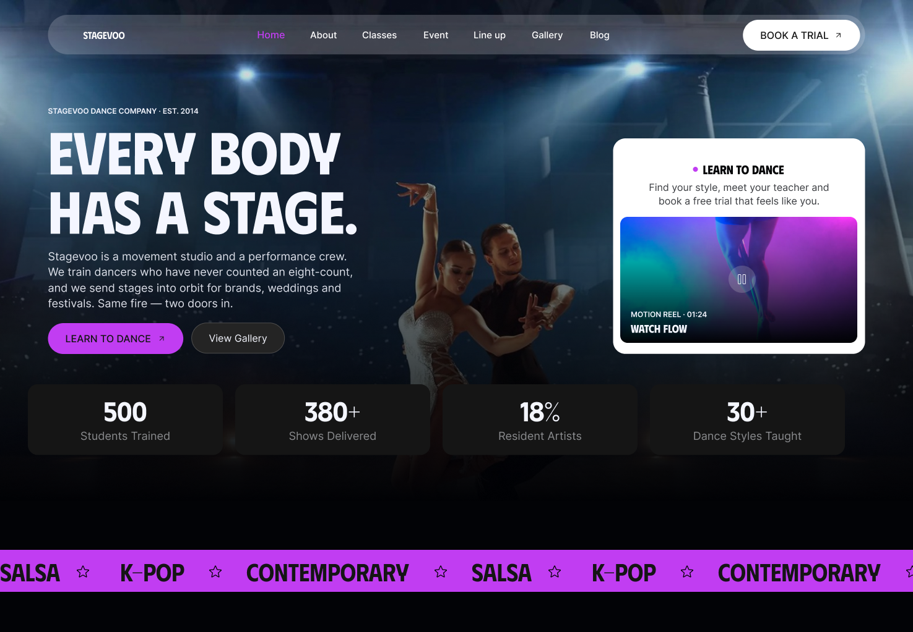
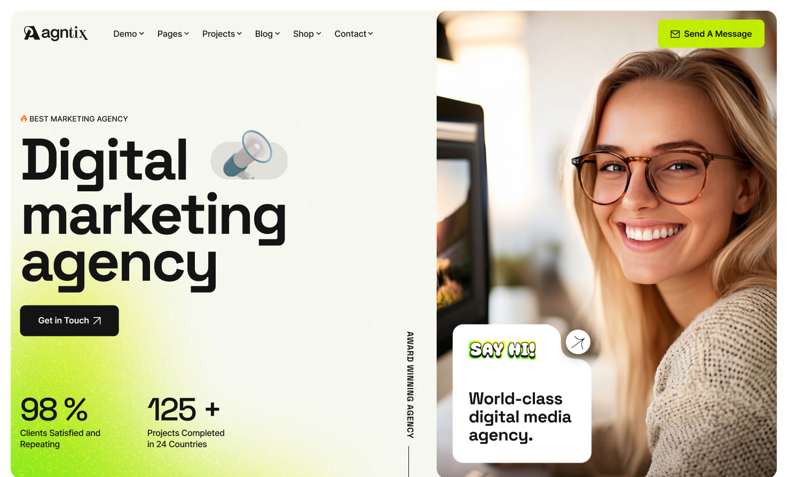
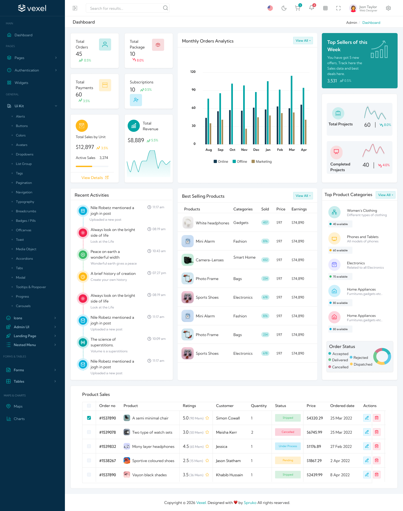

# Internship Works: UI/UX Design at Trends Bird Limited

**Sadman Sakib** (ID: 23-50636-1)
B.Sc. in Computer Science and Engineering (Major in Software Engineering), American International University-Bangladesh (AIUB)
Associate Software Engineer (Intern), Software Development team, Trends Bird Limited, Uttara, Dhaka
Internship period: 3 October 2026 to December 2026

This repository collects the UI/UX design work I did in Figma during my internship. It supports my internship report, *UI/UX Design for Web and Software Products at Trends Bird Limited* (CSC 4299, Fall 2026-2027).

## Contents

| Folder | Work | Type | Figma file |
|---|---|---|---|
| 01_Real_Industry_Project_Commercial_Import_Module | Commercial and import management screens of an enterprise web application for a client | Real client project | Private (client confidential) |
| [02_Own_Design_Stagevoo_Dance_Website](02_Own_Design_Stagevoo_Dance_Website) | Landing page for a fictional dance company: hero, classes, event booking, line-up, gallery, articles and reviews | Own design | [Open in Figma](https://www.figma.com/design/9IRD5iommgxoq7MvT16gcr/Stagevoo-Dance-Company-Website) |
| [03_Practice_Agntix_Agency_Landing_Page](03_Practice_Agntix_Agency_Landing_Page) | Full landing page of a digital marketing agency, rebuilt in Figma for practice | Practice recreation | [Open in Figma](https://www.figma.com/design/KEIFoInl0YtK3cGjLCjVCs/Practice---Agntix-Agency-Landing-Page--Recreation-) |
| [04_Practice_Vexel_Admin_Dashboard_UI_Kit](04_Practice_Vexel_Admin_Dashboard_UI_Kit) | Admin dashboard and UI kit screens: dashboards, widgets, alerts, buttons, avatars, profile and colors | Practice recreation | [Open in Figma](https://www.figma.com/design/20TGVjs9SPPMhVxm88foPW/Practice---Vexel-Admin-Dashboard-UI-Kit--Recreation-) |

**About folder 01:** the real industry project belongs to a client of Trends Bird Limited, so its screens are not published here. Copies with client details hidden can be shown on request, with the company's approval.

**About the practice recreations:** folders 03 and 04 are practice work. I rebuilt existing published designs (the *Agntix* agency template and the *Vexel* admin template by Spruko) in Figma to learn layout, spacing, typography and component structure. The original visual designs belong to their creators.

## What is in each folder

- **02_Own_Design_Stagevoo_Dance_Website:** full page (`stagevoo_full_page_web.jpg`, 1475 × 15350 px) and two section crops
- **03_Practice_Agntix_Agency_Landing_Page:** full page (`agntix_full_page.png`, 1476 × 7823 px) and two section crops
- **04_Practice_Vexel_Admin_Dashboard_UI_Kit:** 21 screens, numbered: dashboards (01-04), widgets (05-08), profile (09-10), notifications (11-12), alerts (13-14), buttons (15-16), avatars (17-18), dropdowns (19) and colors (20-21)

## Previews

### Stagevoo Dance Company Website (own design)

### Agntix Agency Landing Page (practice recreation)

### Vexel Admin Dashboard (practice recreation)

## Tools and skills

- **Figma:** frames, components and variants (including hover states), auto layout, reusable UI elements
- **UI/UX:** visual hierarchy, spacing and alignment, typography, color, consistency, responsive layout thinking
